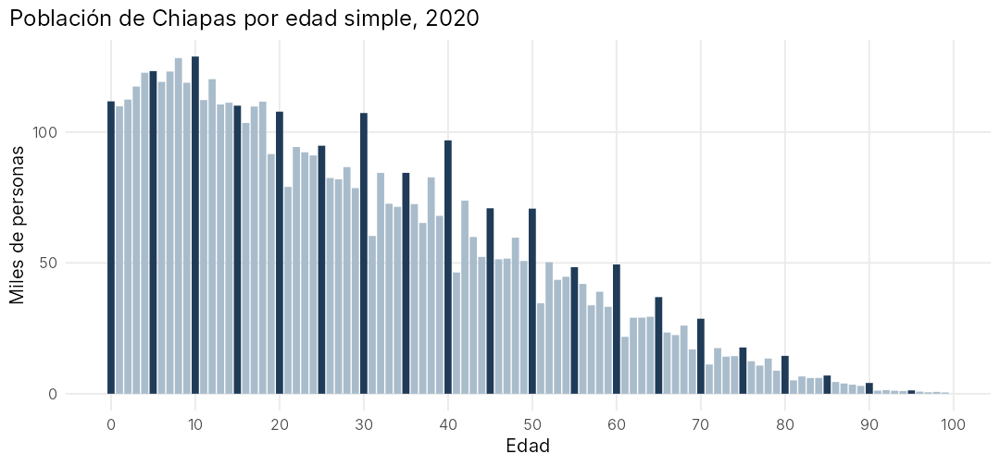
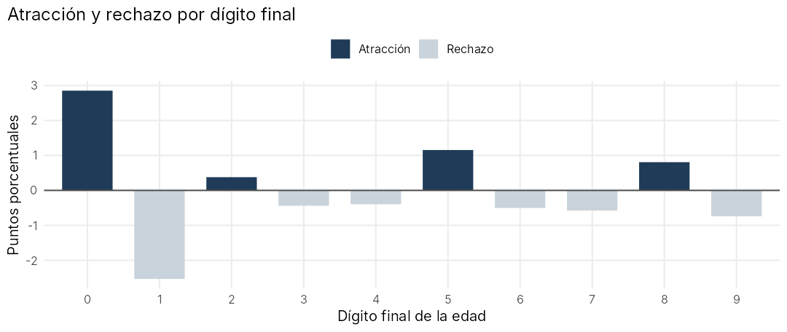

# Age data quality in the 2020 Census: Chiapas

An R project I did for my Demography course (Actuarial Science, Faculty of Sciences, UNAM). It checks how reliable age reporting is in Chiapas in the 2020 Population and Housing Census, and then corrects the population by age group so it can be used in further analysis.

The full report is written in R Markdown (in Spanish): [`reporte_calidad_edad_chiapas.Rmd`](reporte_calidad_edad_chiapas.Rmd). [View the rendered report](https://htmlpreview.github.io/?https://github.com/ManuelRazoAlc/census-age-data-quality-chiapas/blob/main/reporte_calidad_edad_chiapas.html).



## Why it matters

In a census, people often report ages that end in 0 or 5, or someone else in the household answers for them. This "age heaping" distorts the age structure, so its size needs to be measured before the data are used for projections, rates or life tables.

## What I did

- **Whipple index** (ages 23–62): measures the preference for ages ending in 0 and 5.
- **Myers index** (ages 10–79): measures attraction or avoidance for each of the ten final digits.
- **United Nations index**: measures irregularities between five-year age groups for men, women and the sex ratio.
- **Correction**: I distributed the people with unknown age across the age groups (pro rata), smoothed the groups from 10–14 to 70–74 with the 1/16 moving average and rescaled them to keep the total.

## Results

| Index | Value | Classification |
|---|---|---|
| Whipple, ages ending in 0 and 5 | 123.04 | Approximate data |
| Whipple, ages ending in 0 | 128.14 | Deficient data |
| Myers | 10.38 | Medium concentration in some digits |
| United Nations | 11.15 | Satisfactory (five-year groups) |

Single-year ages show clear heaping on 0 (and on 5 to a lesser degree), while the five-year groups are reliable enough to work with once the unknown ages are distributed and the groups are smoothed.



## How it is organized

- `R/funciones_demografia.R`: functions for reading the data, the three indices and the pro-rata correction. They work for any state and year with the same data layout.
- `reporte_calidad_edad_chiapas.Rmd`: the report. It loads the functions, runs every calculation, draws the charts and writes the result tables to `salidas/`.
- `data/chiapas_poblacion_edad_2020.xlsx`: population of Chiapas by sex, single year of age and five-year group.

## How to reproduce it

You need R (4.1 or later) and these packages:

```r
install.packages(c("rmarkdown", "knitr", "readxl", "dplyr", "stringr", "stringi",
                   "tidyr", "purrr", "ggplot2"))
```

Then open `census-age-data-quality-chiapas.Rproj` in RStudio and click **Knit** on the report, or run:

```r
rmarkdown::render("reporte_calidad_edad_chiapas.Rmd")
```

## Data source

INEGI, [Censo de Población y Vivienda 2020](https://www.inegi.org.mx/programas/ccpv/2020/), basic questionnaire: population by sex and age for Chiapas.

---

Manuel Razo Alcántara · [LinkedIn](https://www.linkedin.com/in/manuel-razo-alcantara) · Code under the [MIT License](LICENSE)
